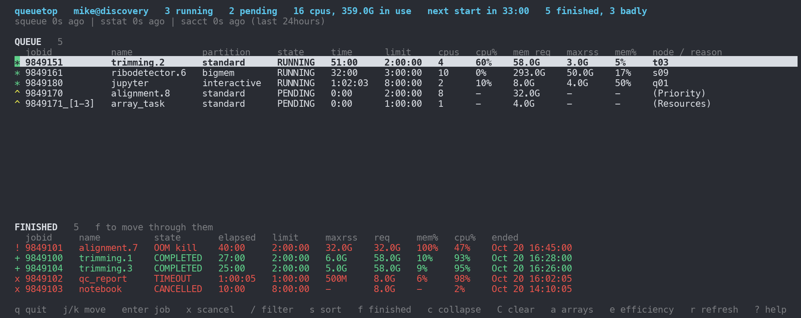
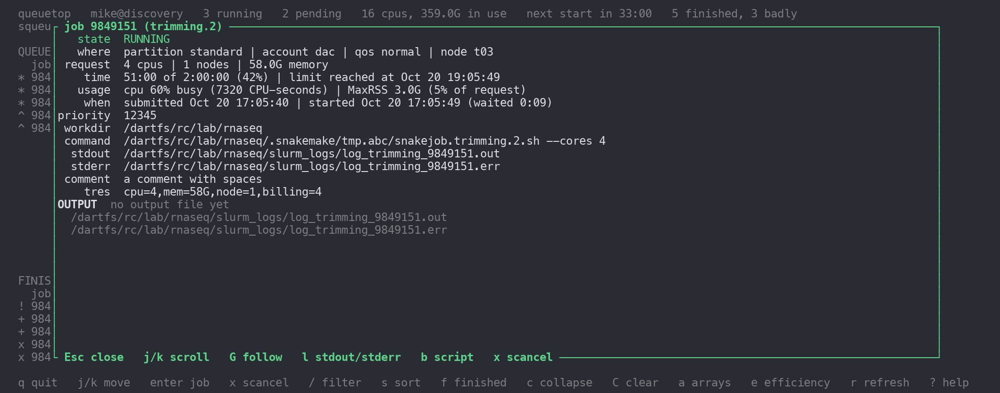

# queuetop

`htop` for your Slurm queue. One static binary; nothing to install on the
cluster.

It shows every job you have in Slurm with live CPU and memory use, the jobs
that finished in the last 24 hours with why they ended, and per job name the
peak usage and the `--mem` / `--time` to request next time.



## Install

Login nodes rarely have Rust, so  a static Linux binary on your own
machine and copy it over.

```bash
curl --proto '=https' --tlsv1.2 -sSf https://sh.rustup.rs | sh   # once; then open a new shell
git clone https://github.com/mikemartinez99/queuetop.git && cd queuetop
scripts/build-linux.sh x86_64 mycluster:bin/      # aarch64 for arm64 clusters; omit the destination to only build
```

On the login node:

```bash
chmod +x ~/bin/queuetop && ~/bin/queuetop --version
```

Runs on any Linux from kernel 3.10 (RHEL 7) up. If `queuetop` is not found,
add `export PATH="$HOME/bin:$PATH"` to `~/.bashrc`.

## Use

```bash
queuetop
```

| Key | Does 
|---|---|
| `j` `k` `↑` `↓` | move the cursor (`J` `K` `PgUp` `PgDn` by page) |
| `Enter` | open the job: details, live usage, output file tail |
| `f` | move through the finished jobs instead of the queue, and back |
| `c` | collapse the finished list, and back |
| `C` | clear the finished list (remembered for a week; jobs that end later still appear) |
| `a` | fold array tasks into one row per array, and back |
| `s` | sort the list under the cursor |
| `/` | filter by jobid, name, partition, state, node or reason; `Esc` clears |
| `e` | efficiency view, and back |
| `x` | `scancel` the job under the cursor, after `y`/`n` |
| `r` | poll now |
| `?` | help |
| `q` | quit |
| mouse | wheel moves the cursor or scrolls the popup; click selects, second click opens |

In the popup: `j` `k` scroll, `G` jump to the end, `l` switch stdout / stderr,
`b` show the batch script, `x` scancel, `Esc` close.



### Options

| Option | Default | Meaning |
|---|---|---|
| `-u, --user NAME` | you | whose jobs |
| `--since WHEN` | `now-24hours` | how far back `sacct` looks (`now-7days`, `2026-10-01`) |
| `--interval S` | 2 | screen refresh |
| `--squeue-interval S` | 5 | queue polling |
| `--sstat-interval S` / `--no-sstat` | 15 | live usage polling |
| `--sacct-interval S` / `--no-sacct` | 60 | finished-jobs polling |
| `--no-cancel` | | disable `x` |
| `--no-mouse` | | leave the mouse to the terminal (text selection) |
| `--bell` | | ring the terminal when jobs end |
| `--on-event CMD` | | run a shell command when jobs end (see below) |
| `--once` | | print a text snapshot and exit (also when stdout is not a terminal) |
| `--json` | | print everything as JSON and exit |

Defaults go in `~/.config/queuetop.toml` (or `$QUEUETOP_CONFIG`), one option
per line by its long name; the command line overrides it:

```toml
since = "now-3days"
sstat-interval = 30
bell = true
```

### `--on-event`

The command runs once per poll through `sh -c`, with:

| Variable | Value |
|---|---|
| `QUEUETOP_EVENT` | `job_failed` if any job ended badly, else `job_completed` |
| `QUEUETOP_COUNT`, `QUEUETOP_JOBIDS` | how many ended, and their ids |
| `QUEUETOP_MESSAGE` | one line describing them |
| `QUEUETOP_JOBID`, `QUEUETOP_NAME`, `QUEUETOP_STATE` | the first job |

```bash
queuetop --on-event '[ "$QUEUETOP_EVENT" = job_failed ] && echo "$QUEUETOP_MESSAGE" | mail -s "slurm: jobs ended badly" you@example.edu'
```

## What the screen shows

**Header**: running and pending counts, cores and memory held, Slurm's estimate
for your next start, finished jobs in the window and how many ended badly;
then how long ago each source answered.

**QUEUE** (`squeue -u you`): one row per job. The marker is the state: `*`
running (green, blinking; red once past 90% of the time limit or memory
request), `^` pending (yellow), `#` anything else (red). `cpu%` and `mem%`
come from `sstat` while a job runs: `cpu%` is CPU seconds used over elapsed
time times cores (100% = every core busy the whole time); `mem%` is the
largest resident set so far over the memory requested. Arrays fold into one row, `123_*`, with cores and memory
summed and `3 running, 10 pending` in the last column.

**FINISHED** (`sacct -u you -S now-24hours`): jobs that ended in the window,
most recent first. Green for completed, red for anything else; `+` completed,
`!` OOM kill, `x` other failure. The state column says `COMPLETED`, `OOM
kill`, `TIMEOUT`, `exit 1`, `signal 9`, `CANCELLED` ... A job that ended
longer ago than the window drops off the list.

**EFFICIENCY** (`e`): finished jobs grouped by name, with the peak elapsed
time, MaxRSS and median CPU efficiency, a `next request` of the form
`--mem=40G --time=1:00:00` (the peaks plus a quarter, rounded up), and a
verdict: `OOM x2: raise mem`, `TIMEOUT x1: raise runtime`, `near time limit`,
`mem over-requested: peak 500M of 8.0G`, or `ok`. After an OOM or TIMEOUT
the peak is the old limit, so raise further if the suggestion still fails.

## Considerations

* `sstat` only answers for your own running jobs, and only once a step is
  running. Until then `cpu%` and `mem%` are `-`.
* On clusters whose accounting plugin does not sample CPU time, `cpu%` stays
  `-` while jobs run and fills in once they finish.
* Fields Slurm has not sampled yet come back as 2^64 - 2 (an absurd time or a
  `cpu%` in the trillions). These are treated as unknown, and any CPU reading
  beyond what the allocation could have consumed is discarded.
* `ReqMem` in the old per-CPU (`2000Mc`) and per-node (`8000Mn`) forms is
  converted to the job total. `MaxRSS` is the largest over the job's steps.
* `sacct` is polled every 60 s and sites' accounting lags by up to a few
  minutes, so a job can leave the queue before it appears as finished.
* `sacct -S now-24hours` also decides which finished jobs are shown; with an
  absolute date (`--since 2026-10-01`) nothing ages out.
* Each command runs in a background thread with a 45 s timeout; a slow
  controller never freezes the screen. A missing `sstat` or `sacct` switches
  itself off; `--no-sacct` skips the attempts on clusters without accounting.
* Mouse capture turns off the terminal's own text selection; use `--no-mouse`
  (or shift-drag in most terminals).
* The batch script (`b`) is only available while Slurm still holds the job.
* Cleared jobs are written to `~/.cache/queuetop/cleared`.
* Cluster name: `SLURM_CLUSTER_NAME`, else the host name.

## Development

```bash
cargo test                        # parsers, the monitor against fake Slurm tools, screen renders, --once/--json
cargo clippy --all-targets
scripts/build-linux.sh [x86_64|aarch64] [scp-destination]
cargo run -q --example dump_screen -- main|popup|efficiency | python3 docs/render_screen.py out.png
```

No dependencies beyond crates.io. `tests/fake/` holds stand-ins for `squeue`,
`sstat`, `sacct`, `scontrol` and `scancel` with canned output; the tests
freeze the clock with `QUEUETOP_NOW` so those jobs stay inside the window.
The screenshots above are rendered from the fake tools.

Layout: `src/slurm.rs` commands, parsers and unit helpers; `src/monitor.rs`
pollers and the per-frame `Snap`; `src/model.rs` derived numbers, array
folding, verdicts; `src/text.rs` formatting, tables, `--once`; `src/ui.rs`
screens, keys, mouse; `src/app.rs` event loop; `src/json.rs`; `src/events.rs`
hooks; `src/tail.rs` output tail; `src/config.rs`; `src/clock.rs`.

## AI disclosure

Most of this repository was written by Claude (Anthropic Fable 5.1) in
sessions directed by myself (Mike Martinez). I set the goals, chose the features,
reviewed the results and ran the tool independently on my institution's HPC. I hope that
queueTop serves you well!